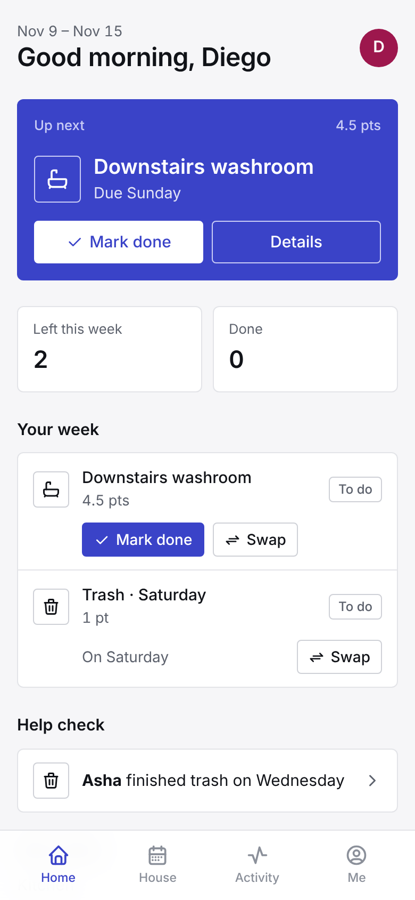
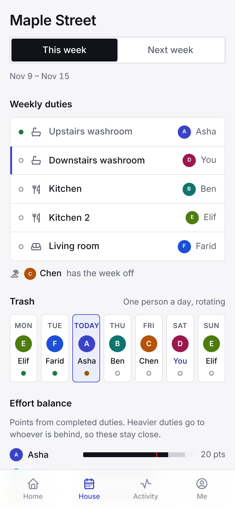
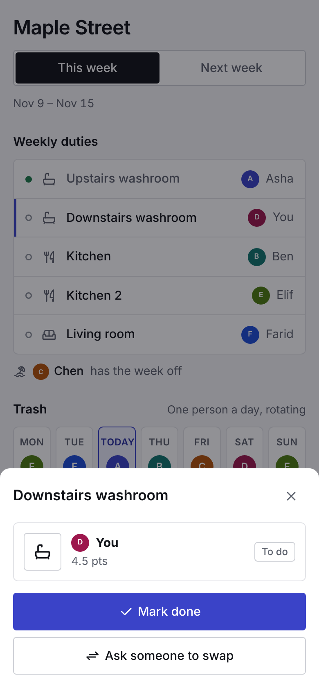

# House Rota


An installable app that runs our shared house's weekly duties: who cleans which washroom, the kitchen, the living room, and whose night it is for trash. It plans the whole week at once so duties never collide, balances effort over time, handles people being away, and reminds everyone with free push notifications.

<p>
  
  
  
</p>

## Why

Six of us share a house with two washrooms (each shared by three people), a kitchen that needs two people a week, a living room, and trash every day. Our previous app rotated each chore separately, so the rotations collided: someone would get both kitchen slots, or a washroom and the kitchen in the same week, while someone else had nothing. It also treated every chore as equal effort, and whoever covered for a traveling housemate got no credit.

## What it does

- **Plans the whole week together, under hard rules.** A washroom only goes to the people who use it, the two kitchen slots go to different people, nobody gets two weekly duties, and nobody who's away gets anything. Within those rules it picks the plan that keeps everyone's effort most even.
- **Effort points the house agrees on.** Everyone rates each duty from 1 to 5; points are the average, so heavier duties count for more.
- **Trash as a rotating cycle.** One person a day; with 6 people and 7 days, the order moves along by one each week.
- **Away dates that correct themselves.** Your duties move to someone fair; whoever covers earns the points, and you get a bit more after you're back.
- **Swaps, nudges and checks.** Ask someone to swap or take a duty. Finished duties wait 24 hours for a housemate to confirm or flag them, with an optional photo that's deleted after 7 days. Anonymous nudges replace reminding people yourself. Everything is in an append-only activity feed.
- **Free reminders.** Push notifications for trash nights, weekly duties, swaps and nudges, on iPhone and Android, with no app store.
- **Self-serve onboarding.** A setup wizard, single-use invite links you share in WhatsApp, and a 6-digit PIN for each person.

## Stack

| Layer | Choice | Why |
|---|---|---|
| App | React 19 + TypeScript, installable PWA with a service worker | One codebase for iPhone and Android, no store fees |
| API | A standard `fetch` handler on Cloudflare Workers | Always on, free, fast everywhere |
| Database | Cloudflare D1 (SQLite) | Free; atomic batches for every write |
| Reminders | Cron Trigger every 15 minutes plus Web Push | Free, no third-party service |
| Push crypto | RFC 8291 payload encryption and RFC 8292 VAPID, written on Web Crypto | No library needed, runs inside Workers |

The server code is runtime-independent: in tests and `npm run local` the same handler runs on Node with its built-in SQLite.

## Engineering notes

**Scheduling.** With 6 people and 5 weekly slots there are at most a few thousand combinations, so the scheduler tries every valid one and keeps the cheapest (the sum of squared differences from the house's average effort, plus a penalty for repeating recent duties). Exhaustive search is provably optimal at this size and fits in a millisecond, well within the Workers free plan's CPU budget. See `src/domain/scheduler.ts`.

**Consistency without transactions.** D1 has no interactive transactions, only atomic batches. Every change reads first, then writes with guarded statements (for example `UPDATE ... WHERE status = 'pending'`), and history events are inserted with `WHERE changes() > 0` so an event exists only if its change happened.

**PINs on a 10 ms CPU budget.** Slow hashes like scrypt don't fit the free plan. A 6-digit PIN has only a million values anyway, so the real protection is rate limiting (5 attempts per person per 15 minutes, stored in the database because Worker isolates don't share memory). PINs are HMAC'd with a secret pepper, so a leaked database alone can't be brute-forced offline.

**Push.** Payloads are end-to-end encrypted to each browser's key, so push services can't read reminders. Each reminder has a stable key recorded before sending, so a retry never double-notifies, and dead subscriptions are removed automatically. Subscription endpoints must be HTTPS push URLs, so the server can't be turned into a request relay.

**Security.** `HttpOnly`, `SameSite=Lax`, `Secure` session cookies stored as hashes; an Origin check on every write; strict CSP with no inline scripts; photos type-checked by content; a setup code so nobody else can claim the house; single-use, expiring invite links.

## Development

```bash
npm install
npm test            # 43 tests: scheduler, trash cycle, house logic, API, push encryption
npm run typecheck
npm run demo        # sample house, PIN 246810
npm run build && npm run local   # http://localhost:8787
```

For live-reloading frontend work, run `npm run local` and `npm run dev:web` together, then open http://localhost:5173.

Deploying to Cloudflare for free: see [DEPLOY.md](DEPLOY.md).

## License

MIT
